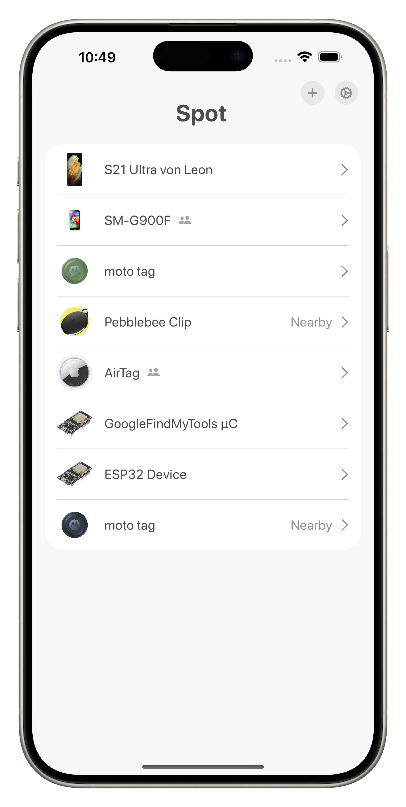
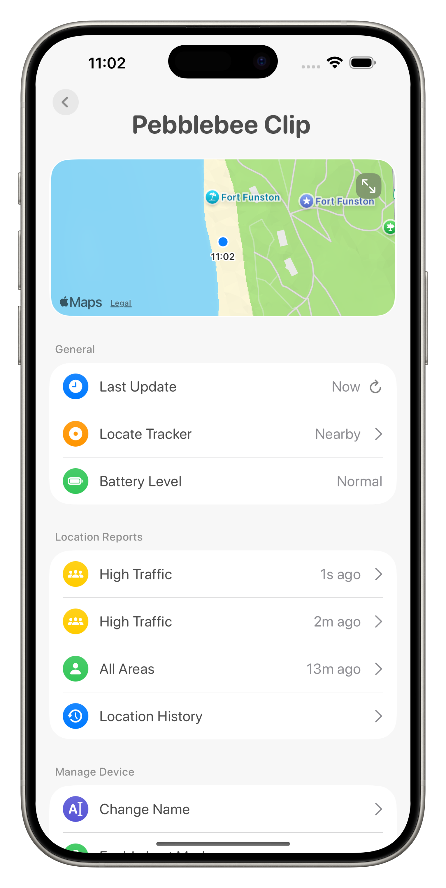
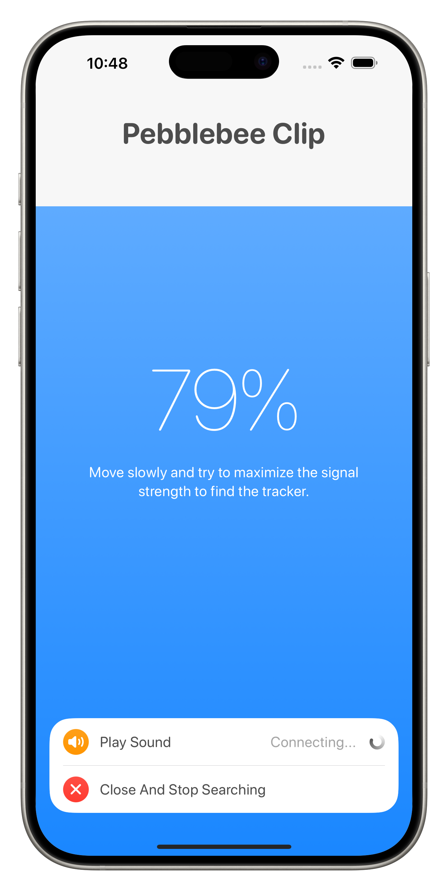

# Spot

Spot is an unofficial iPhone and iPad client for Google Find My Device / Find Hub trackers.

## Screenshots

<p align="center">
  
  
  
</p>

## Features

- Sign in with your own Google account and recover the encryption keys for your trackers.
- View existing trackers, manually refresh encrypted location reports, and browse locally stored location history.
- Find nearby trackers over Bluetooth and play their sound.
- Rename trackers, accept sharing invitations, manage sharing and lost mode, or remove an existing device.
- Create an ESP32-based tracker and copy its identifier for the ESP32 firmware.
- Report real sightings of your own nearby trackers, including during background Bluetooth scanning when permission is granted.

Pair commercial trackers using a compatible Android phone. ESP32 tracker creation is available through Add Device → Create Own Device. For the ESP32 firmware and an explanation of how it works, see [GoogleFindMyTools](https://github.com/leonboe1/GoogleFindMyTools).

## Build

You need macOS, Xcode 16.1 or newer, and an iPhone or iPad running iOS/iPadOS 18.1 or newer. A simulator can display the interface; Bluetooth tracker communication requires a physical device.

1. Open `Spot.xcodeproj` in Xcode. Allow Swift Package Manager to resolve the public dependencies.
2. Select your signing team and a bundle identifier in the Spot target's Signing & Capabilities settings.
3. Build and run. Grant the Bluetooth and location permissions you want to use, then sign in with your own account.

The Firebase client configuration required by the service integration is included. Account tokens and tracker keys are acquired at runtime and are not included in the source.

To check an unsigned simulator build:

```sh
xcodebuild -project Spot.xcodeproj -scheme Spot -configuration Release \
  -destination 'generic/platform=iOS Simulator' \
  -derivedDataPath /tmp/SpotBuild CODE_SIGNING_ALLOWED=NO build
```

## Source layout

- `Spot/`: SwiftUI app, Bluetooth communication, account authentication, encrypted network requests, and local persistence.
- `Licenses/`: notices for third-party code and public package dependencies.

## Data and service limitations

Sign-in happens in an embedded Google web view. Persistent authentication tokens, owner and shared encryption keys, and FCM/GCM credentials are stored locally in Keychain. Ordinary preferences remain in UserDefaults, and location history uses Core Data. Logging out clears authentication and stored Keychain credentials but retains local location history.

The Bluetooth discovery flow matches trackers against the signed-in account's device list before reporting. Location collection uses the existing Core Location freshness and accuracy filters. Ordinary sighting uploads follow the `uploadInterval` setting, which defaults to disabled. Automatic unwanted-tracking-mode resets attempt a location upload before sending the Bluetooth command, regardless of whether the upload succeeds. Background updates depend on system scheduling and granted permissions.

This app uses unofficial service protocols. Service changes can break login, push delivery, device management, or location retrieval. This release has no guarantee of service compatibility and is not affiliated with or endorsed by Google.

## License and icon

Copyright © 2024–2026 Leon Böttger. The application code is licensed under **GNU GPL version 3 only**, subject to the third-party notices. See [LICENSE](LICENSE) for the full license and [LICENSING.md](LICENSING.md) for scope.

**The Spot app icon is excluded from the open-source license. All rights to the icon artwork are reserved.** This includes the images in `Spot/Assets.xcassets/AppIcon.appiconset/` and `Spot/Assets.xcassets/AppIconHighRes.imageset/`. Obtain separate permission to reuse or redistribute the icon, or replace these assets before distributing your own build.

Third-party code retains its own license.
